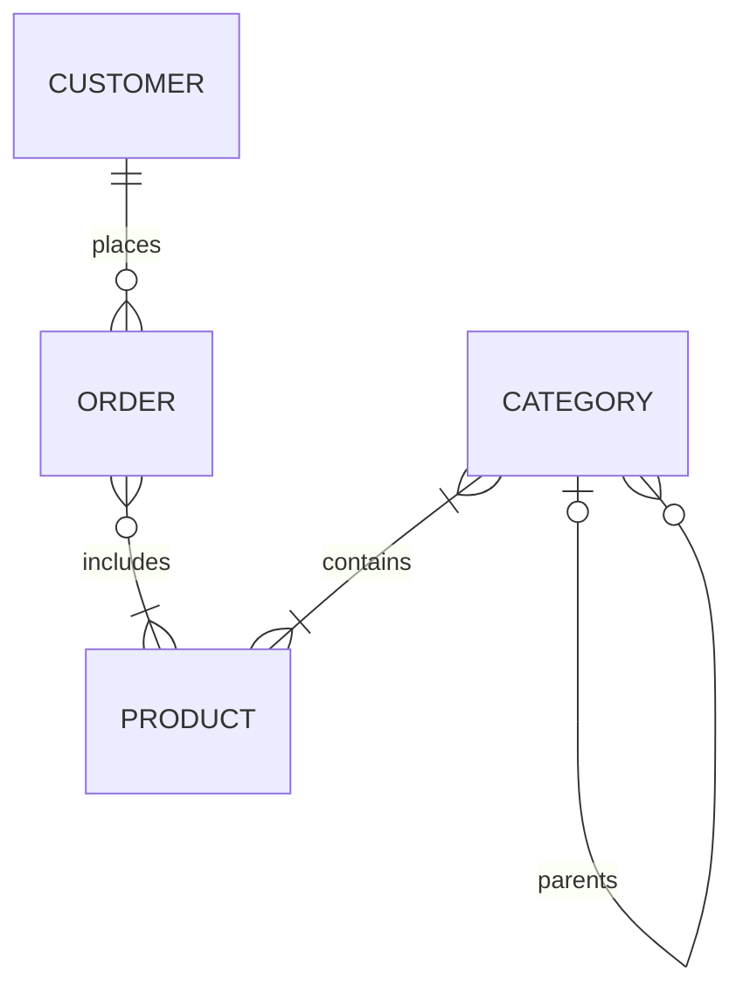

# Chapter 5: Planning the Database

## Book Information

- **Book:** Practical Web Database Design
- **Authors:** Chris Auld, Allan Kent, Rudy Limeback, Nigel Stanger, and Thearon Willis
- **Chapter:** 5 — Planning the Database
- **Repository:** Practical-Web-Database-Design-Notes

## 1. Chapter Goal

This chapter develops a **conceptual data model** for a web store.

The starting point is the information the business needs to store, rather than SQL statements or table definitions.

The planning process has four steps:

1. Gather information.
2. Identify entities and attributes.
3. Identify entity relationships.
4. Prepare the conceptual data model.

The resulting model describes the important entities, their relationships, and the business rules governing those relationships.

Implementation details follow in Chapter 6.

## 2. Web Store Requirements

The example web store must allow:

- Customers to browse products, place orders, and track order status through their browsers.
- The store owner to manage product inventory.
- The store owner to analyze the business through reports.

Database designers need information from stakeholders to understand these requirements.

Relevant stakeholders may include the store owner, potential customers, and people familiar with customer behavior.

**Requirements must come from the business. A reasonable assumption for one project may be wrong for another.**

## 3. Gather Information

The purpose of information gathering is to discover which data must be stored to support the required behavior.

A feature may appear to concern only application processing, yet still reveal additional data requirements.

| Requirement | Data implications |
|---|---|
| Display products | Product names, descriptions, prices, images, and other product details |
| Organize browsing | Categories and product-category relationships |
| Manage inventory | Quantity on hand |
| Remove products from sale | Product status |
| Fulfill orders | Ordered products, quantities, shipping information, and costs |
| Track orders | Customer identification and order information |
| Process payments | Payment outcome |
| Produce reports | Data supporting each requested analysis |

### 3.1 Product Information

The preliminary product information identified in the chapter includes:

| Attribute | Purpose |
|---|---|
| Product name | Identifies the product to customers |
| Short description | Provides a brief summary |
| Long description | Provides more detailed information |
| Size | Describes product size |
| Color | Describes product color |
| Weight | Records product weight |
| Price | Records the selling price |
| Availability / quantity on hand | Indicates available inventory |
| Picture or image | Supports visual presentation |
| Comments from satisfied customers | Provides customer feedback for display |
| Special discounts | Describes promotional offers |
| Shipping cost | Records product-related shipping charges |

This is an initial information list, not a final table definition.

Some items may require further modeling during implementation.

For example, identifying customer comments as information to store does not yet settle whether comments should remain an attribute or become a separate entity.

### 3.2 Product Administration

The store owner needs administrative functions to:

- Add products.
- Change descriptions and prices.
- Move products between categories.
- Offer discounts.
- Remove products from the store.

Reviewing these operations helps uncover additional storage requirements.

#### Administrative Access

Customers must not have access to product administration.

This reveals a requirement to identify the store owner and authorize administrative access.

The book mentions an owner ID and password but excludes administrative account modeling from the example to keep the design focused. Security is discussed in Chapter 7.

#### Removing Products Without Losing History

A product that has already been sold should not simply be deleted if doing so would damage historical order information.

The chapter introduces a product status:

```text
active / deleted
```

Changing the status allows the product to disappear from customer-facing listings while its stored information remains available.

This approach is commonly called **soft deletion**.

**Important:** Product status was discovered during requirements gathering, even though it is absent from the chapter's later preliminary attribute list. It remains a requirement that must be carried into the subsequent design.

### 3.3 Reporting Requirements

The owner may want to know:

- Which products or categories sold the most or least?
- Which customers or customer types bought particular products?
- Were special discount offers effective?

Each report must be checked against the information planned for storage.

**A report cannot reliably provide information that the system never captured.**

For example, evaluating a particular discount requires enough information to identify the purchases associated with that discount.

Detailed report development can happen later, but reporting requirements may affect database design now.

## 4. Order Information

In the chapter's scenario, the store owner fulfills and ships orders.

The database therefore needs to retain enough order information for fulfillment, sales tracking, and analysis.

The preliminary order information includes:

- Products ordered.
- Quantity of each product.
- Discounts.
- Total shipping cost.
- Taxes, if applicable.
- Total cost.

These items do not all belong at the same level.

| Information | Meaning |
|---|---|
| Products ordered | A relationship between Order and Product |
| Quantity of each product | Data about a particular product within a particular order |
| Total shipping cost | Information about the order as a whole |
| Taxes and total cost | Order-level information in the preliminary model |
| Discounts | Must be clarified according to whether they apply to an item, an order, or both |

For example, the same product may have quantity `2` in one order and quantity `5` in another.

Therefore, ordered quantity does not describe the product independently. It describes its participation in a specific order.

## 5. Customer Information

Every order in the example is associated with a specific customer.

However, the desire to analyze customers does not mean that every possible personal detail should be collected.

### 5.1 Information Needed to Complete a Purchase

The chapter identifies two essential requirements:

1. Valid payment authorization.
2. Information about where, and possibly how, to ship the products.

A customer name and shipping address may be involved.

**Payment authorization does not mean the store must retain the customer's payment credentials.**

### 5.2 Optional Information and Privacy

Additional customer information may be useful to the owner but unnecessary for completing the purchase.

For example:

> Is this purchase a gift or for personal use?

A customer may decline to answer or provide an inaccurate answer.

Requiring unnecessary answers can cause the customer to abandon the purchase.

The practical distinction is:

- Information required to fulfill the purchase must be available.
- Additional information should generally be optional.

The chapter also highlights privacy legislation.

**Source clarification:** The legal examples reflect the book's publication period. They should not be treated as a statement of current legal requirements.

### 5.3 Email and Order Tracking

An email address can support shipment confirmation.

Tracking orders through the web store introduces another requirement: returning customers must be able to identify themselves and access their orders.

The chapter therefore identifies:

- Customer user ID / login ID.
- Customer password.

**Security clarification:** In an implementation, store a suitable password hash rather than a plaintext password. Password hashing is an implementation clarification, not a separate entity introduced by this chapter.

## 6. Payment Processing

The chapter's example delegates payment authorization to a third-party payment processor.

The general sequence is:

1. The customer visits the processor's secure payment page.
2. The customer enters payment information there.
3. The processor returns an approval or denial.
4. The web store records the outcome against the order.

The important distinction is between:

- **Processing payment credentials**, handled by the payment processor in this scenario.
- **Recording the payment outcome**, handled by the web store.

If payment is denied, the application may let the customer:

- Abandon the order.
- Save the order and attempt payment later.

**A failed payment does not necessarily require deleting the order.**

The payment-provider names in the chapter are historical examples, not current recommendations.

## 7. Identify Entities and Attributes

After gathering requirements, identify the entities and the information describing them.

| Concept | Meaning | Example |
|---|---|---|
| Entity | A type of thing about which information is stored | Product |
| Attribute | A property describing an entity | Product price |
| Relationship | An association between entities | Product belongs to Category |

Separate attributes from relationships so that each can be analyzed clearly.

### 7.1 Preliminary Entities

The chapter identifies four main entities:

1. Product.
2. Category.
3. Customer.
4. Order.

### 7.2 Preliminary Attributes

| Entity | Preliminary attributes |
|---|---|
| Product | Name, short description, long description, size, color, weight, price, quantity on hand, image, customer comments, special discounts, shipping cost |
| Category | Name, description |
| Customer | Name, email address, ship-to address, login ID, password |
| Order | Discounts, total shipping cost, taxes, total cost |

Additional requirements discovered earlier include product status and payment outcome.

The preliminary lists must be reconciled with those requirements during subsequent design.

### 7.3 Do Not Confuse Relationships with Attributes

The book lists “products ordered” under Order, but this describes an association with Product.

Similarly:

- A product's category is an association with Category.
- An order's customer is an association with Customer.
- A category's parent is an association with another Category.

Ordered quantity belongs to the Order–Product association.

**These lists are conceptual planning material, not finished relational schemas.**

## 8. Identify Entity Relationships

For each relationship, examine both directions.

Use this question:

> Each instance of X is related to how many instances of Y?

Then reverse it:

> Each instance of Y is related to how many instances of X?

One direction does not fully determine the other.

### 8.1 Cardinality and Optionality

Cardinality records how many instances may participate in a relationship.

For precise rules, record both the minimum and maximum.

| Notation | Meaning |
|---|---|
| `0..1` | Zero or one |
| `1..1` | Exactly one |
| `0..*` | Zero or more |
| `1..*` | One or more |

- A minimum of `0` means participation is optional.
- A minimum of `1` means participation is mandatory.
- A maximum of `1` means at most one related instance.
- A maximum of `*` means many related instances are allowed.

### 8.2 Crow's Foot Notation

In the notation used by the chapter:

- A crow's foot indicates “many.”
- A small circle indicates that zero is allowed.
- A bar indicates “one”; its combination with the other symbols expresses the relevant minimum and maximum.

Read the symbols at an end as describing how many instances at that end relate to one instance at the opposite end.

For example, a circle and crow's foot at the Order end of a Product–Order relationship mean that one product may appear in zero or many orders.

The exact drawing convention may vary. The business rule must remain unambiguous.

## 9. Category and Product

Examine the relationship in both directions.

### 9.1 How Many Products Can a Category Contain?

The chapter chooses:

> Each category contains one or more products.

```text
Category → Products: 1..*
```

The reasoning is that customers should not encounter empty categories while browsing.

The application may therefore need to hide empty categories.

**Implementation clarification:** Hiding an empty category is a visibility rule. It does not, by itself, prevent an empty category record from existing during administration. The conceptual rule and its enforcement need to be reconciled during implementation.

### 9.2 How Many Categories Can a Product Belong To?

The chapter chooses:

> Each product belongs to one or more categories.

```text
Product → Categories: 1..*
```

A product must have a category to appear in category-based browsing, and it may belong to multiple categories.

**Supplementary example:**

A sports shirt might appear under both:

- Clothing.
- Sportswear.

### 9.3 Resulting Relationship

The relationship is **many-to-many**.

| Direction | Cardinality |
|---|---|
| Category → Products | `1..*` |
| Product → Categories | `1..*` |

These minimums are decisions made for this example, not universal rules for every store.

### 9.4 Default Category and Sales Reporting

Multiple categories introduce a reporting question:

> Which category receives credit when a product is sold?

The chapter proposes a default category for sales tracking.

Identifying one category as the default for a particular product describes the **relationship between that product and category**.

This is an example of **relationship data**.

### 9.5 Later Relational Implementation

A relational design normally represents this many-to-many association using an associative entity and two one-to-many relationships.

The detailed implementation is deferred to Chapter 6.

## 10. Order and Product

The relationship between Order and Product is also **many-to-many**, but its minimum cardinalities differ.

### 10.1 How Many Orders Can Include a Product?

The chapter chooses:

> Each product can be ordered by zero, one, or more orders.

```text
Product → Orders: 0..*
```

A newly introduced product may not have been ordered yet.

A product may also appear in many orders over time.

A unique product with only one available unit can still fit this model. Inventory availability constrains its sale; the general relationship does not need to become one-to-one.

### 10.2 How Many Products Must an Order Include?

The chapter chooses:

> Each order is for one or more products.

```text
Order → Products: 1..*
```

An order without a product is not treated as an order in this model.

Allowing multiple products also avoids forcing customers to create a separate order for every product.

### 10.3 Resulting Relationship

| Direction | Cardinality |
|---|---|
| Product → Orders | `0..*` |
| Order → Products | `1..*` |

The relationship is many-to-many because both maximum cardinalities are “many.”

**A minimum of zero does not change a many-to-many relationship into another relationship type.**

### 10.4 Ordered Quantity Is Relationship Data

**Supplementary example:**

| Order | Product | Quantity |
|---|---|---|
| Order A | Notebook | 2 |
| Order B | Notebook | 5 |

The quantity varies according to both the order and product.

During relational implementation, an associative entity—commonly named OrderItem or OrderDetail—can hold this information.

Those names are conventional examples; the chapter has not yet finalized the physical structure.

## 11. Category and Subcategory

### 11.1 Is Subcategory a Separate Entity?

The chapter concludes that a subcategory is not intrinsically different from a category.

Both have:

- A name.
- A description.

“Subcategory” describes a category's position beneath another category.

The same entity can therefore represent categories at every level.

### 11.2 Recursive Relationship

A recursive relationship connects instances of an entity to other instances of the same entity.

Here, Category participates in two roles:

- Parent.
- Child.

This supports categories, subcategories, and further nested levels without defining a separate entity for each level.

### 11.3 How Many Children Can a Category Have?

The chapter chooses:

> Each category can contain zero, one, or more subcategories.

```text
Category → Children: 0..*
```

A category can have several children.

A category at the bottom of the hierarchy has none.

### 11.4 How Many Parents Can a Category Have?

The chapter chooses:

> Each category belongs to zero or one parent category.

```text
Category → Parent: 0..1
```

A top-level category has no parent.

Every other category has one parent.

Allowing no more than one parent is a design decision for this example.

### 11.5 Recursive Does Not Necessarily Mean One-to-Many

The chapter describes its selected recursive structure as one-to-many.

**Clarification:** Recursive relationships can also be many-to-many in other designs. Recursion means that an entity relates to itself; it does not determine cardinality.

The example deliberately restricts each category to one parent.

### 11.6 Identical Names Do Not Mean Identical Categories

The name “Programming” may occur under different parents.

For example:

- Computers → Programming.
- Computers → Education → Programming.
- Computers → Parallel Computing → Programming.

These can be different categories with the same name.

Their shared label does not make them the same entity instance.

## 12. Customer and Order

In this example, Customer is directly related to Order.

### 12.1 How Many Orders Can a Customer Have?

The chapter chooses:

> Each customer places zero, one, or more orders.

```text
Customer → Orders: 0..*
```

A customer may register before making a purchase.

A returning customer may place many orders.

### 12.2 How Many Customers Can an Order Belong To?

The chapter chooses:

> Each order is placed by exactly one customer.

```text
Order → Customer: 1..1
```

The application must know who placed the order.

Shared orders belonging to multiple customers are excluded from this example.

### 12.3 Resulting Relationship

The relationship is **one-to-many**.

| Direction | Cardinality |
|---|---|
| Customer → Orders | `0..*` |
| Order → Customer | `1..1` |

A customer can exist without an order.

An order cannot exist without its customer under these rules.

## 13. Why There Is No Direct Customer–Product Purchase Relationship

Customers buy products through orders.

The purchase association is already represented by:

1. Customer–Order.
2. Order–Product.

These relationships let the system determine which customers bought which products.

A separate direct Customer–Product relationship is not needed to represent the same purchase.

**Scope clarification:** Other requirements, such as wish lists or product reviews, could introduce additional associations. They are separate requirements and are not established by the purchase model alone.

## 14. Prepare the Conceptual Data Model

Combine the individual relationships into one overall model.

### 14.1 Complete Relationship Rules

| Starting entity | Related entity or role | Cardinality | Business rule |
|---|---|---|---|
| Category | Products | `1..*` | Each category contains one or more products |
| Product | Categories | `1..*` | Each product belongs to one or more categories |
| Product | Orders | `0..*` | A product may never have been ordered or may appear in many orders |
| Order | Products | `1..*` | An order contains at least one product |
| Customer | Orders | `0..*` | A customer may have no orders or many orders |
| Order | Customer | `1..1` | Every order belongs to exactly one customer |
| Category | Child categories | `0..*` | A category may have no children or many children |
| Category | Parent category | `0..1` | A category has no parent or one parent |

### 14.2 Conceptual ER Diagram



Read the diagram together with the relationship table.

The Category–Category line represents parent and child roles within the same entity.

The many-to-many relationships remain visible at this conceptual stage.

### 14.3 What the Model Establishes

The conceptual model identifies:

- The entities of interest.
- Their business meaning.
- Their relationships.
- Minimum and maximum participation.
- Important design decisions.

It does not yet finalize:

- SQL table definitions.
- Column data types.
- Primary and foreign key implementation.
- Associative table details.
- Indexes.
- The mechanisms enforcing every business rule.

## 15. Moving Toward Implementation

Chapter 6 builds on this conceptual model.

Two relationships require associative entities in the relational design:

| Many-to-many relationship | Later implementation approach |
|---|---|
| Product–Category | An associative entity linking products and categories |
| Order–Product | An associative entity linking orders and products |

Each associative entity turns the many-to-many association into two one-to-many relationships.

Relationship data, such as ordered quantity or the default-category designation, must also be placed appropriately.

**Modeling clarification:** Associative entities can be introduced during logical modeling as well. Their postponement here follows the book's teaching sequence.

## 16. Important Distinctions

| Distinction | Explanation |
|---|---|
| Requirement vs. implementation | A business need does not yet specify its SQL structure |
| Attribute vs. relationship | Price describes Product; category membership connects entities |
| Entity type vs. entity instance | Category is a type; one specific category is an instance |
| Maximum cardinality vs. optionality | “Many” describes the maximum; zero or one establishes the minimum |
| Recursive relationship vs. separate entity | Subcategories can be instances of Category |
| Shared name vs. shared identity | Categories with identical names can be different instances |
| Product availability vs. relationship cardinality | Stock limits selling, while cardinality describes allowed associations |
| Payment credentials vs. payment outcome | The processor handles credentials in this scenario; the store records the result |
| Removing from display vs. deleting history | Status can hide a product while retaining historical references |
| Conceptual model vs. relational schema | The first expresses business structure; the second defines its relational representation |

## 17. Common Mistakes to Avoid

- Designing tables before understanding stakeholder requirements.
- Assuming the reverse direction of a relationship without examining it.
- Recording only “one” or “many” and ignoring whether zero is allowed.
- Treating all listed information as simple entity attributes.
- Storing ordered quantity as a property of Product alone.
- Creating a different entity for every category hierarchy level.
- Assuming recursive relationships must always be one-to-many.
- Treating categories with the same name as the same category.
- Deleting sold products without considering historical data.
- Expecting reports to recover information that was never recorded.
- Treating the book's example decisions as universal business rules.
- Confusing a conceptual model with a finished database implementation.

## 18. Review Checklist

- [ ] I can explain the four planning steps in order.
- [ ] I understand why stakeholder requirements must guide the design.
- [ ] I can explain how administrative operations reveal data requirements.
- [ ] I understand why sold products may need soft deletion.
- [ ] I can check whether stored data supports a requested report.
- [ ] I can distinguish essential purchase information from optional customer information.
- [ ] I can distinguish payment credentials from payment outcomes.
- [ ] I can identify the four main entities and their preliminary attributes.
- [ ] I can distinguish attributes from relationships.
- [ ] I can analyze every relationship in both directions.
- [ ] I can interpret `0..1`, `1..1`, `0..*`, and `1..*`.
- [ ] I understand how crow's foot notation represents participation.
- [ ] I can explain the Product–Category many-to-many relationship.
- [ ] I understand why a default category is relationship data.
- [ ] I can explain the Order–Product many-to-many relationship.
- [ ] I understand why ordered quantity belongs to the order-product association.
- [ ] I can explain the recursive Category relationship.
- [ ] I know that the single-parent restriction is an example-specific decision.
- [ ] I can explain why identical category names do not establish identical identity.
- [ ] I can explain the Customer–Order one-to-many relationship.
- [ ] I understand why purchases do not require a separate direct Customer–Product relationship.
- [ ] I can read the combined conceptual model.
- [ ] I know which relationships require associative entities during relational implementation.
- [ ] I can distinguish the chapter's conceptual decisions from later implementation details.
